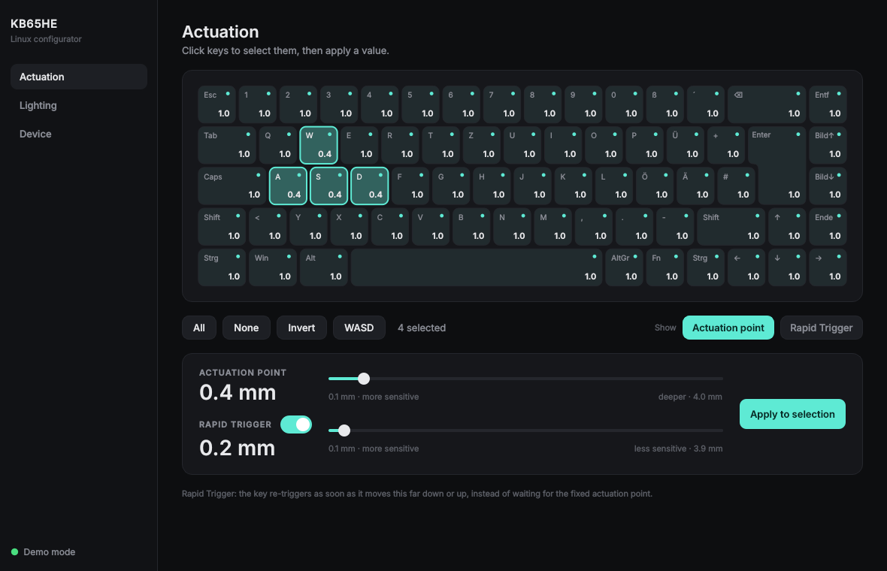
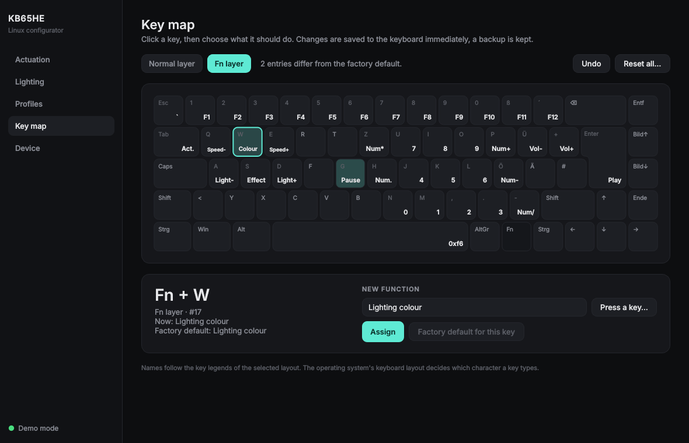

# kb65he-linux

Unofficial Linux configurator for the **Endgame Gear KB65HE 8k** hall-effect keyboard.
The official software only runs on Windows. This project talks to the keyboard directly
over hidraw, so no driver, Wine or VM is needed.

> **Not affiliated with Endgame Gear.** The protocol was reverse-engineered for
> interoperability. Use at your own risk. Firmware updates are intentionally not supported.



## Features

| | |
|---|---|
| **Actuation point** | per key or for all keys, 0.1–4.0 mm, click/drag keys to select |
| **Rapid trigger** | per key, 0.1–3.9 mm or off |
| **Lighting** | on/off, 11 effects, brightness, speed, 7 colour slots |
| **Profiles** | save, load, import and export all settings as JSON |
| **Live preview** | the lighting page shows an animated preview of the chosen effect |
| **Live key view** | pressed keys light up in the GUI |
| **Key map** | remap any key on the normal and the Fn layer (keys, media, lighting, mouse buttons), with undo and automatic backups |
| **Device info** | serial, change counter |
| **CLI** | everything above from the terminal |

Settings are stored on the keyboard itself, so they persist on other computers.



Not yet supported: SOCD, DKS, macros.
See [docs/PROTOCOL.md](docs/PROTOCOL.md) for what is known so far.

## Supported hardware

| USB ID | Model | Status |
|---|---|---|
| `3367:5035` | KB65HE 8k, ISO (DE/UK…) | tested |
| `3367:5036` | KB65HE 8k, ANSI | untested, layout view is ISO |
| `3367:5025/5026` | KB65HE (1 kHz, original) | not supported (different firmware) |

Check yours with `lsusb | grep 3367`.

## Installation

### Debian / Ubuntu / Pop!_OS / Mint (.deb)

Download `kb65he_<version>_all.deb` from the [latest release](https://github.com/JulianFriedle/kb65he-linux/releases/latest), then:

```bash
sudo apt install ./kb65he_*_all.deb
```

This installs the CLI, the GUI (app menu: *KB65HE Configurator*), the udev rule and uses the
distribution's PyQt6. Unplug and replug the keyboard once afterwards. Requires Ubuntu 24.04 /
Debian 12 or newer.

### Any distribution (pipx)

```bash
git clone https://github.com/JulianFriedle/kb65he-linux.git
cd kb65he-linux

# 1. allow your user to access the keyboard (once)
sudo cp udev/70-kb65he.rules /etc/udev/rules.d/
sudo udevadm control --reload-rules && sudo udevadm trigger
# then unplug and replug the keyboard

# 2. install (pipx keeps it isolated; uses PySide6)
pipx install ".[gui]"

# 3. optional: app menu entry
install -Dm644 data/kb65he.desktop ~/.local/share/applications/kb65he.desktop
install -Dm644 src/kb65he/gui/icon.svg ~/.local/share/icons/hicolor/scalable/apps/kb65he.svg
```

Start the GUI with `kb65he-gui` (or from the app menu). Try it without a keyboard: `kb65he-gui --demo`.

## CLI

```bash
kb65he info
kb65he actuation                    # list all keys
kb65he actuation 1.0 --all          # all keys to 1.0 mm
kb65he actuation 0.4 W A S D        # by name (DE or UK legend) or key number
kb65he rapid-trigger 0.2 W A S D    # rapid trigger distance
kb65he rapid-trigger off --all
kb65he lighting
kb65he set-lighting --effect static --brightness 6 --color 255,80,0
kb65he profile save Gaming          # profiles in ~/.config/kb65he/profiles
kb65he profile list
kb65he profile load Gaming
kb65he backup ~/kb65he-backup.json  # any file
kb65he restore ~/kb65he-backup.json
kb65he keymap                       # show the key assignment (normal + Fn layer)
kb65he keymap set G PAUSE --fn     # Fn+G sends Pause (a backup is saved first)
kb65he keymap reset-default         # factory key map
kb65he -v info                      # show raw packets
```

## Development

```bash
python3 -m venv .venv && source .venv/bin/activate
pip install -e ".[gui,dev]"
pytest
kb65he-gui --demo
```

The UI language follows `LANG` (German or English); override with `KB65HE_LANG=en`.

## Releasing

Bump `__version__` in `src/kb65he/__init__.py` and push to `main`. The GitHub Action runs the
tests, creates the tag `vX.Y.Z`, builds the Python package and the `.deb` and publishes a release with generated notes.

## How it works

The keyboard exposes a vendor HID interface (usage page `0xFF01`, interface 2) that
exchanges 64-byte packets with a simple checksum. Commands read or write blocks such
as the lighting settings or the per-key trigger table. Details: [docs/PROTOCOL.md](docs/PROTOCOL.md).

Contributions are welcome, especially USB captures of features that are not decoded yet.

## License

GPL-3.0. See [LICENSE](LICENSE).
